&nbsp;

AGARTALA, INDIA &nbsp; · &nbsp; FRONTEND ENGINEERING &nbsp; · &nbsp; UI/UX DESIGN

### About me

I'm **Amlan Bhowmik** — a frontend developer and UI/UX designer turning complex workflows into clean, intuitive digital experiences.

I build responsive interfaces, reusable components, and thoughtful design systems, while exploring mobile development and backend architecture.

### Toolkit

Technologies I use and explore.

**Frontend & Interface Design**

**Backend & Databases**

**Mobile & Infrastructure**

**Tools & Workflow**

Includes technologies I'm learning, not a claim of equal proficiency in every tool.

### What I work on

<table>
<tr><td width="33%" align="center"><b>Interface Engineering</b>
Responsive UI, design systems, and thoughtful interactions
</td>
<td width="33%" align="center"><b>Complex Workflows</b>
Dashboards, forms, and administrative experiences
</td>
<td width="33%" align="center"><b>Beyond the Browser</b>
Flutter, APIs, databases, and Docker
</td></tr>
</table>

Some professional work lives in private repositories, so public activity only tells part of the story.

### GitHub activity

### Let's connect

Interested in building useful products and carefully crafted digital experiences.

&nbsp;

DESIGN WITH PURPOSE. &nbsp; <b>BUILD WITH CARE.</b>

